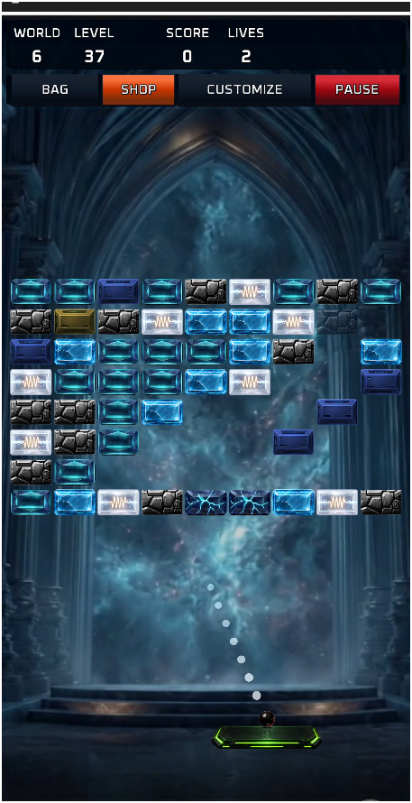
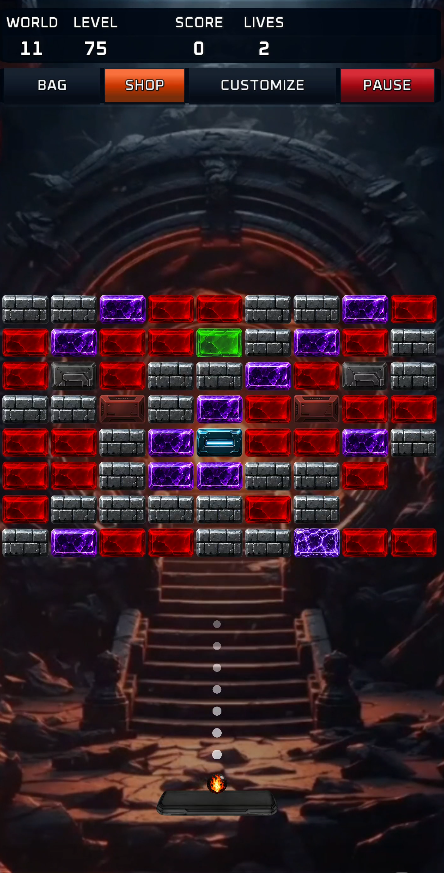
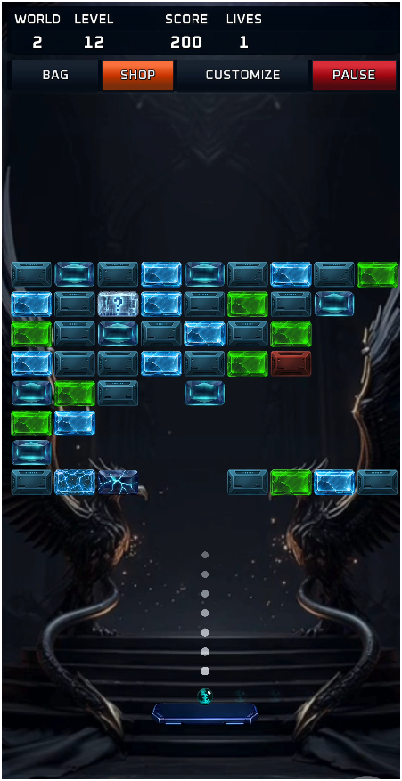
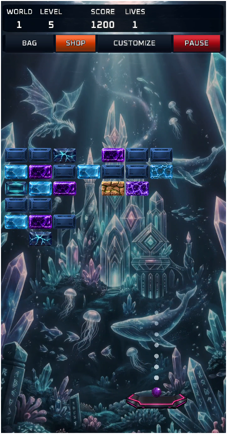
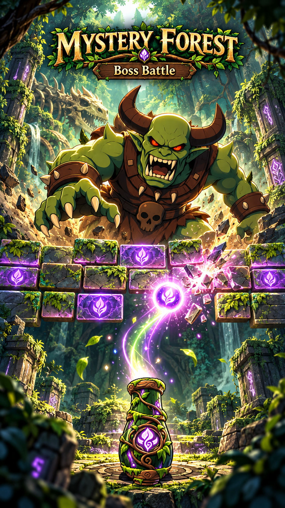
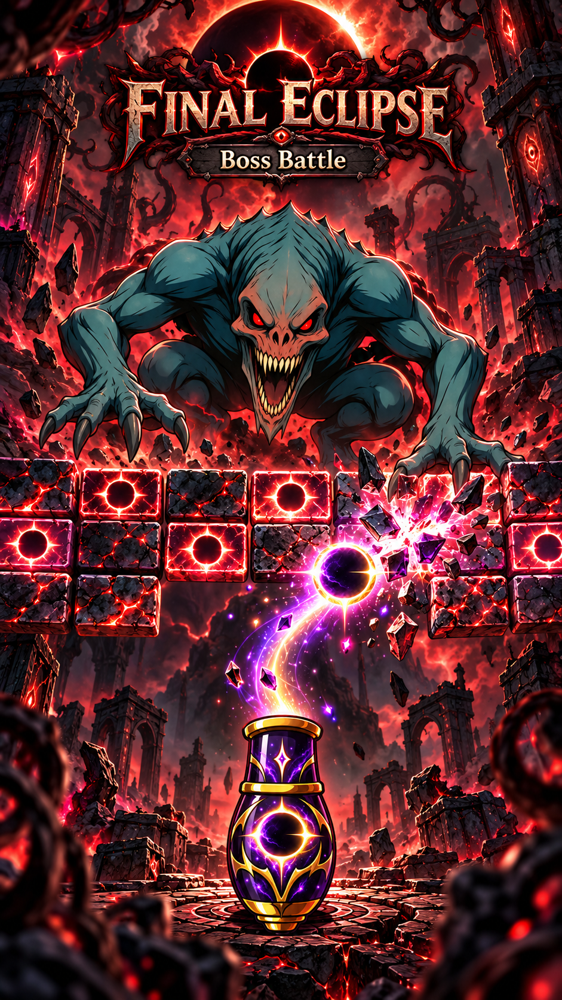
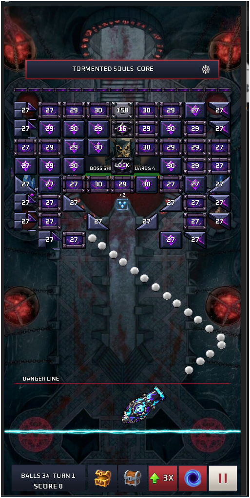

# Brick Breaker Ball Web

[](README_AR.md)

A bilingual website for the Volley-only **Brick Breaker Ball** Android game. It includes a nine-world gallery, rules and privacy pages, a small playable Volley preview, and a current 160-stage campaign lab.

English is available at `/en` and Arabic is available at `/ar`.

<p>
  
  
  
  
</p>

[](https://nextjs.org/)
[](https://react.dev/)
[](https://www.typescriptlang.org/)
[](https://tailwindcss.com/)
[](https://developer.mozilla.org/en-US/docs/Web/API/Canvas_API)
[](https://pnpm.io/)

## Overview

The site uses the Next.js App Router and presents the game's content and assets across desktop, tablet and mobile layouts. The play page has a small HTML5 Canvas preview of Volley aiming, ball volleys and brick collisions.

The preview is a browser adaptation, not the LibGDX Android runtime. The Android project defines the playable 90-stage campaign; the site uses its Volley artwork and world structure.

## Features

- English and Arabic interfaces with separate routes.
- 90 Volley campaign stages across nine worlds, with ten stages and one boss encounter per world.
- Volley boss artwork, gameplay screenshots and stage backgrounds from the Android project.
- Mouse and touch aiming in the small browser preview.
- Current 160-stage campaign viewer and playable sandbox with 165 real ball choices.
- Separate rules and privacy pages in both languages.
- Responsive styling built with Tailwind CSS.

---

<p>


</p>

<p>

</p>

## Routes

| Route | Description |
| --- | --- |
| `/` | Redirects to the default English version |
| `/en` | English home page |
| `/en/play` | English browser game |
| `/en/rules` | English rules |
| `/en/privacy` | English privacy page |
| `/terms` | Public Terms of Service URL (English) |
| `/en/terms` | English Terms of Service |
| `/ar` | Arabic home page |
| `/ar/play` | Arabic browser game |
| `/ar/rules` | Arabic rules |
| `/ar/privacy` | Arabic privacy page |
| `/ar/terms` | Arabic Terms of Service |

## Project Structure

```text
BrickBreakerBall-Web/
├── app/                        # Routes, layouts and global styles
│   ├── en/                     # English routes
│   └── ar/                     # Arabic routes
├── components/                 # Site and game components
│   ├── PlayableVolleyDemo.tsx  # Small Volley browser preview
│   ├── PlayPage.tsx            # Play page
│   ├── HomePage.tsx            # Home page
│   ├── PageShell.tsx           # Shared wrapper and language direction
│   ├── SiteHeader.tsx          # Navigation
│   ├── SiteFooter.tsx          # Footer
│   ├── RulesPage.tsx            # Rules page
│   ├── RulesMarkdown.tsx        # Markdown renderer
│   └── PrivacyPage.tsx          # Privacy page
├── content/                   # Rules and ball metadata
├── lib/site.ts                # Copy, languages, worlds and links
├── public/game/               # Images, audio, sprites and videos
│   ├── volley-world/          # Numbered campaign backgrounds and atlases
│   ├── volley-Bosses/         # World boss artwork
│   └── site/                  # Site branding and screenshots
├── next.config.ts             # Next.js configuration
├── package.json               # Scripts and dependencies
└── pnpm-lock.yaml             # Locked dependency versions
```

## Technologies

- **Next.js 15 App Router:** routing, layouts and metadata.
- **React 19:** component composition and interactive state.
- **TypeScript:** typed application and asset data.
- **Tailwind CSS 4:** responsive UI styling.
- **HTML5 Canvas:** Volley preview board, bricks, balls and HUD rendering.
- **`requestAnimationFrame`:** game loop and physics updates.
- **Web Audio:** brick, wall, power-up and explosion sounds.
- **Pointer Events:** shared mouse and touch controls.

## Local Development

Requirements: Node.js compatible with Next.js 15 and pnpm.

```bash
pnpm install
pnpm dev
```

Open `http://localhost:3000`.

Set the production URL used by Open Graph metadata with:

```env
NEXT_PUBLIC_SITE_URL=https://example.com
```

## Production Build

```bash
pnpm check
pnpm build
pnpm start
```

If development reports a missing generated chunk such as `Cannot find module './17.js'`, stop Next.js, remove `.next`, and start it again:

```powershell
Remove-Item .next -Recurse -Force
pnpm dev
```

## Deployment

Import the repository into Vercel and use the default Next.js settings. Add `NEXT_PUBLIC_SITE_URL` with the production URL. Stage Lab replaces the former editor at `/en/editor` and `/ar/editor`, embedding `/volley/stage-gallery.html`. It uses the current Android gallery and only its referenced sprites. Run `pnpm sync:gallery` after regenerating the Android gallery, then `pnpm check:gallery`. The former editor and sprite cutter are removed.

To refresh Stage Lab without building Android or starting a server:

1. In the Android checkout, run `python scripts/generate_volley_stage_gallery.py`. The static exporter mirrors the current loader's finale placement, stable brick IDs, 2/3/4 skull locks, campaign damage progression, and individual ball strengths.
2. In this website checkout, run `pnpm sync:gallery` followed by `pnpm check:gallery` and `pnpm check`. Sync rejects an export whose runtime fingerprint no longer matches the Android loader, health rules, abilities, and ball catalog.
3. Publish the website commit to the connected Vercel project. Each stage uses a content-addressed filename; `sync-manifest.json` records exact file hashes and the runtime fingerprint. The embedded viewer and every script/style URL use content revisions so visitors receive the updated catalog and interface together. Only referenced runtime artwork is copied.

Inspection starts with a closer **Formation** view. **Arena** shows the complete play area, **Find boss** locates the finale, and Pan/zoom can reveal higher rows. HP labels are abbreviated and fitted to each square or triangle; the inspector retains exact health. In the browser sandbox, bosses are invulnerable until every skull lock is broken, and defeating a boss leaves other objectives intact. The header reports remaining locks and announces when the boss becomes vulnerable. Browser simulation remains separate from Android device validation; website play never changes Android progress or purchases.

## Privacy and Scope

Public pages and Stage Lab do not require sign-in. The sandbox runs locally in the browser and does not write progress to Firebase. Firebase Realtime Database rules continue to restrict editor data access to the configured administrator.

The site presents all 160 campaign stages with inspection and playable browser previews. The full game and saved campaign progression run in the Android app.
