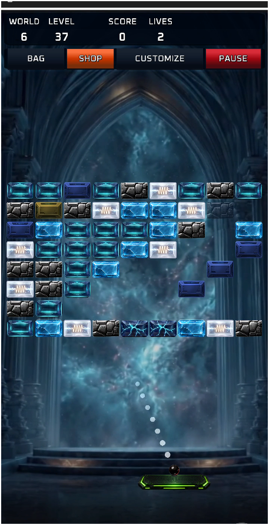
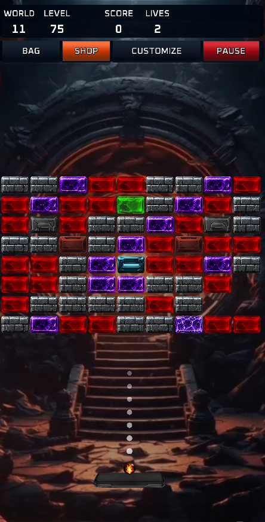
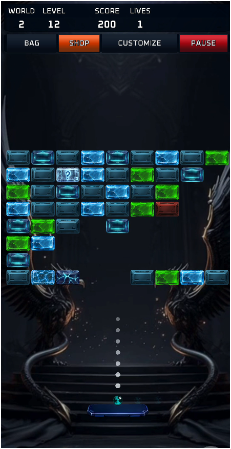
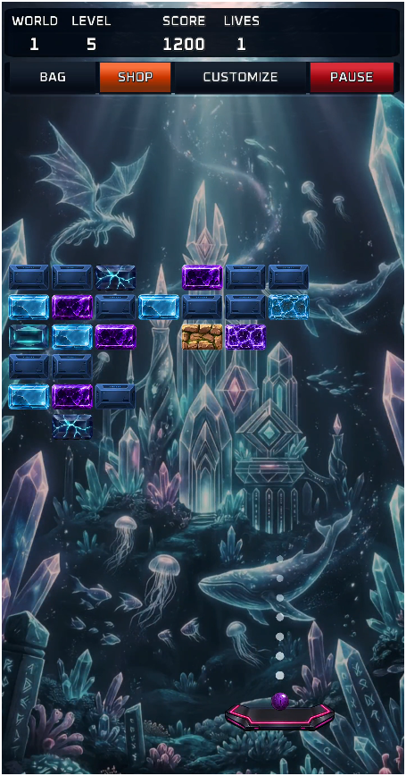
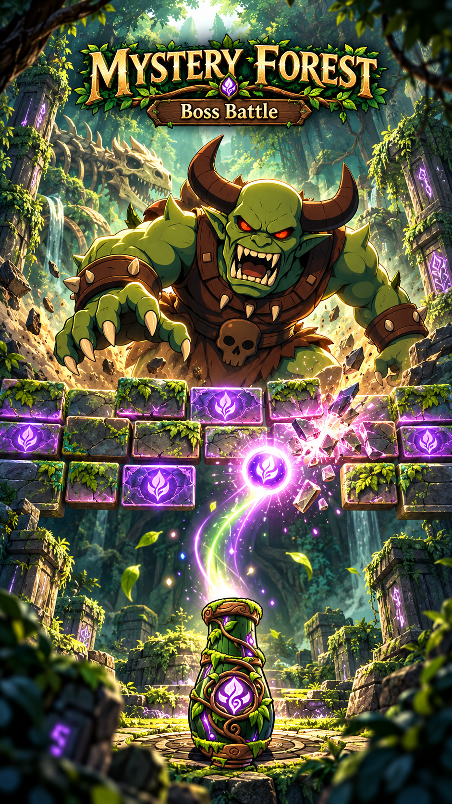
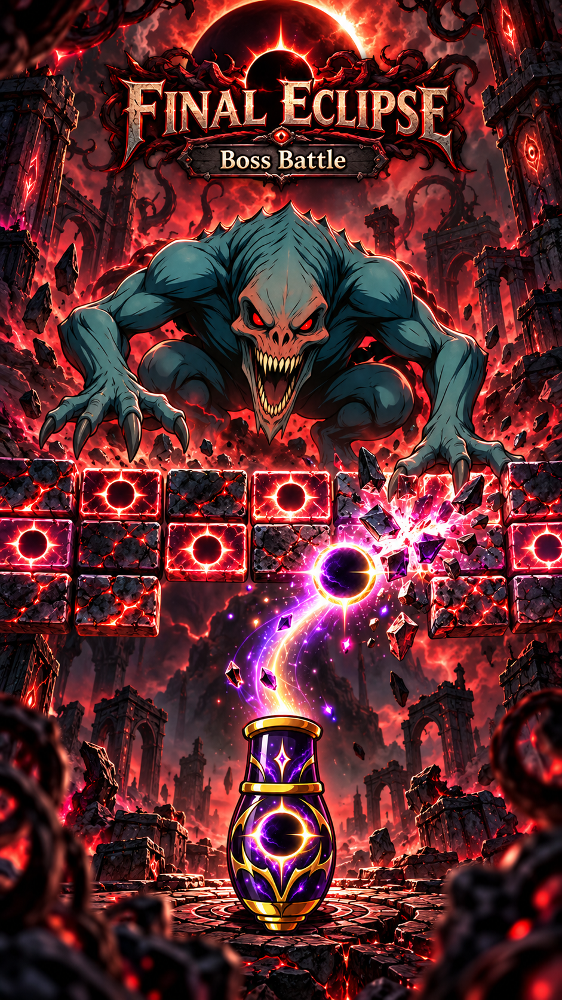
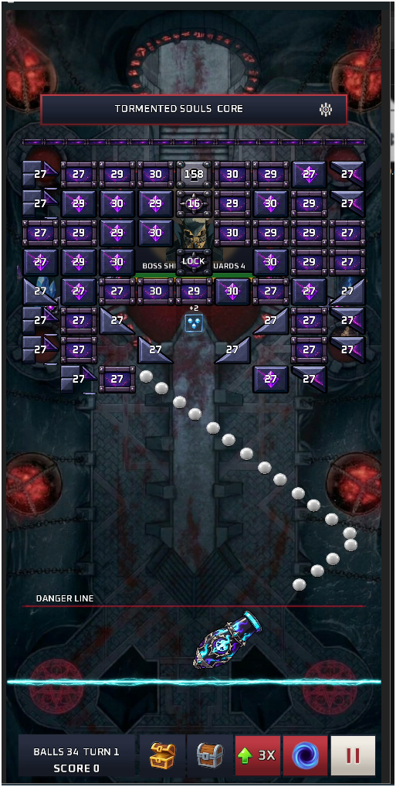

# Brick Breaker Ball Web

[](README_AR.md)

A bilingual website for the Volley-only **Brick Breaker Ball** Android game. It includes a nine-world gallery, rules and privacy pages, a small playable Volley preview, and an admin stage editor.

English is available at `/en` and Arabic is available at `/ar`.

<p>
  
  
  
  
</p>

[](https://nextjs.org/)
[](https://react.dev/)
[](https://www.typescriptlang.org/)
[](https://tailwindcss.com/)
[](https://developer.mozilla.org/en-US/docs/Web/API/Canvas_API)
[](https://pnpm.io/)

## Overview

The site uses the Next.js App Router and presents the game's content and assets across desktop, tablet and mobile layouts. The play page has a small HTML5 Canvas preview of Volley aiming, ball volleys and brick collisions.

The preview is a browser adaptation, not the LibGDX Android runtime. The Android project defines the playable 90-stage campaign; the site uses its Volley artwork and world structure.

## Features

- English and Arabic interfaces with separate routes.
- 90 Volley campaign stages across nine worlds, with ten stages and one boss encounter per world.
- Volley boss artwork, gameplay screenshots and stage backgrounds from the Android project.
- Mouse and touch aiming in the small browser preview.
- Admin Volley stage editor and sprite-sheet cutter.
- Separate rules and privacy pages in both languages.
- Responsive styling built with Tailwind CSS.

---

<p>


</p>

<p>

</p>

## Routes

| Route | Description |
| --- | --- |
| `/` | Redirects to the default English version |
| `/en` | English home page |
| `/en/play` | English browser game |
| `/en/rules` | English rules |
| `/en/privacy` | English privacy page |
| `/ar` | Arabic home page |
| `/ar/play` | Arabic browser game |
| `/ar/rules` | Arabic rules |
| `/ar/privacy` | Arabic privacy page |

## Project Structure

```text
BrickBreakerBall-Web/
├── app/                        # Routes, layouts and global styles
│   ├── en/                     # English routes
│   └── ar/                     # Arabic routes
├── components/                 # Site and game components
│   ├── PlayableVolleyDemo.tsx  # Small Volley browser preview
│   ├── PlayPage.tsx            # Play page
│   ├── HomePage.tsx            # Home page
│   ├── PageShell.tsx           # Shared wrapper and language direction
│   ├── SiteHeader.tsx          # Navigation
│   ├── SiteFooter.tsx          # Footer
│   ├── RulesPage.tsx            # Rules page
│   ├── RulesMarkdown.tsx        # Markdown renderer
│   └── PrivacyPage.tsx          # Privacy page
├── content/                   # Rules and ball metadata
├── lib/site.ts                # Copy, languages, worlds and links
├── public/game/               # Images, audio, sprites and videos
│   ├── volley-world/          # Numbered campaign backgrounds and atlases
│   ├── volley-Bosses/         # World boss artwork
│   └── site/                  # Site branding and screenshots
├── next.config.ts             # Next.js configuration
├── package.json               # Scripts and dependencies
└── pnpm-lock.yaml             # Locked dependency versions
```

## Technologies

- **Next.js 15 App Router:** routing, layouts and metadata.
- **React 19:** component composition and interactive state.
- **TypeScript:** typed application and asset data.
- **Tailwind CSS 4:** responsive UI styling.
- **HTML5 Canvas:** Volley preview board, bricks, balls and HUD rendering.
- **`requestAnimationFrame`:** game loop and physics updates.
- **Web Audio:** brick, wall, power-up and explosion sounds.
- **Pointer Events:** shared mouse and touch controls.

## Local Development

Requirements: Node.js compatible with Next.js 15 and pnpm.

```bash
pnpm install
pnpm dev
```

Open `http://localhost:3000`.

Set the production URL used by Open Graph metadata with:

```env
NEXT_PUBLIC_SITE_URL=https://example.com
```

## Production Build

```bash
pnpm check
pnpm build
pnpm start
```

If development reports a missing generated chunk such as `Cannot find module './17.js'`, stop Next.js, remove `.next`, and start it again:

```powershell
Remove-Item .next -Recurse -Force
pnpm dev
```

## Deployment

Import the repository into Vercel and use the default Next.js settings. Add `NEXT_PUBLIC_SITE_URL` with the production URL. The public pages are static; the admin editor uses Firebase for sign-in and cloud saves.

## Privacy and Scope

Public pages do not require a player account. The admin editor uses Google sign-in through Firebase and can save stage and sprite workspace data to the configured database.

The site presents all 90 campaign stages and offers an editable stage workspace. The playable browser preview is a small Volley demonstration; the full campaign runs in the Android app.
