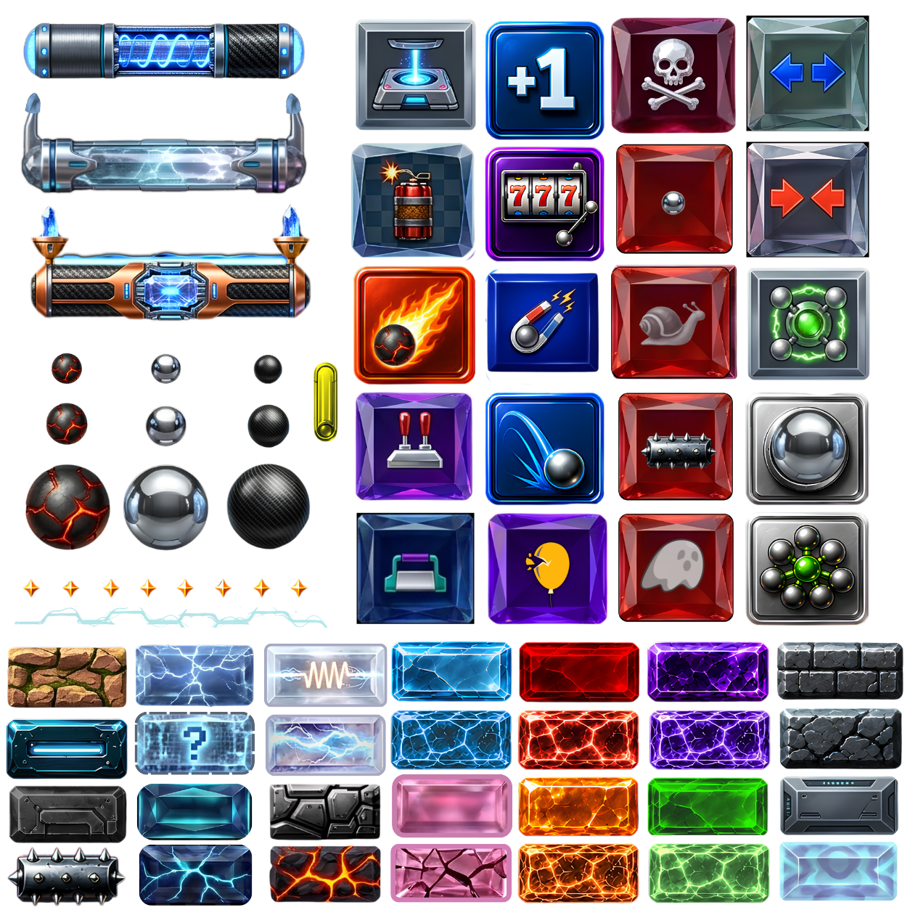

# Brick Breaker Ball Web

[](README.md)

نسخة ويب ثنائية اللغة من لعبة **Brick Breaker Ball**. يحتوي المشروع على صفحات الموقع، معرض العوالم، صفحات القوانين والخصوصية، ونسخة HTML5 قابلة للعب داخل المتصفح.

النسخة الإنجليزية متاحة في `/en` والنسخة العربية متاحة في `/ar`.

<p dir="ltr">
  
  
  
  
</p>

[](https://nextjs.org/)
[](https://react.dev/)
[](https://www.typescriptlang.org/)
[](https://tailwindcss.com/)
[](https://developer.mozilla.org/en-US/docs/Web/API/Canvas_API)
[](https://pnpm.io/)

## نظرة عامة

الموقع مبني باستخدام Next.js App Router، ويعرض محتوى اللعبة وأصولها على الكمبيوتر والتابلت والجوال. تستخدم صفحة اللعب HTML5 Canvas لمحاكاة حركة البادل، فيزياء الكرة، اصطدام البلوكات، المراحل، الأرواح، القوى والبلوكات الخاصة.

المشروع إعادة تنفيذ للويب وليس نسخة مباشرة من مشغل لعبة Android المبنية بمحرك LibGDX. يستخدم بيانات الحملة، الصور، الأصوات، الفيديوهات وبيانات الـ Sprite Sheets المتوفرة في المشروع الأصلي.

## المزايا

- واجهة عربية وإنجليزية بمسارات مستقلة.
- 90 مرحلة موزعة على 13 عالمًا.
- خلفيات فيديو متحركة للعوالم من `public/game/worlds`.
- 60 كرة قابلة للاختيار من مجلد `balls_set`.
- 36 مجموعة Paddle Style Sets، وكل مجموعة تحتوي `Normal` و`Weapon` و`Sticky`.
- عرض البادلز من Sprite Sheets بالاعتماد على بيانات JSON.
- تحكم بالماوس واللمس والأسهم ومفاتيح `A` و`D`.
- حفظ التقدم والتجهيزات المختارة باستخدام `localStorage`.
- صفحات مستقلة للقوانين والخصوصية باللغتين.
- تصميم متجاوب باستخدام Tailwind CSS.

---

<p>



</p>

## صفحات الموقع

| المسار | الوصف |
| --- | --- |
| `/` | تحويل تلقائي إلى النسخة الإنجليزية |
| `/en` | الصفحة الرئيسية بالإنجليزية |
| `/en/play` | اللعبة بالإنجليزية |
| `/en/rules` | قوانين اللعبة بالإنجليزية |
| `/en/privacy` | الخصوصية بالإنجليزية |
| `/ar` | الصفحة الرئيسية بالعربية |
| `/ar/play` | اللعبة بالعربية |
| `/ar/rules` | قوانين اللعبة بالعربية |
| `/ar/privacy` | الخصوصية بالعربية |

## هيكل المشروع

```text
BrickBreakerBall-Web/
├── app/                        # المسارات والتخطيط العام
│   ├── en/                     # صفحات النسخة الإنجليزية
│   └── ar/                     # صفحات النسخة العربية
├── components/                # مكونات الموقع واللعبة
│   ├── GameCanvas.tsx          # الرسم والفيزياء واختيار التجهيزات
│   ├── PlayPage.tsx            # صفحة اللعب
│   ├── HomePage.tsx            # الصفحة الرئيسية
│   ├── PageShell.tsx           # الغلاف العام واتجاه اللغة
│   ├── SiteHeader.tsx          # شريط التنقل
│   ├── SiteFooter.tsx          # التذييل
│   ├── RulesPage.tsx            # صفحة القوانين
│   ├── RulesMarkdown.tsx        # عرض ملفات Markdown
│   └── PrivacyPage.tsx          # صفحة الخصوصية
├── content/                   # القوانين وبيانات الكور
├── lib/site.ts                # النصوص واللغات وبيانات العوالم
├── public/game/               # الصور والأصوات والفيديوهات
│   ├── assets/                # البلوكات والمؤثرات والقوى
│   ├── audio/                 # المؤثرات الصوتية
│   ├── sprites/               # Sprite Sheets وملفات JSON
│   └── worlds/                # فيديوهات العوالم من 1 إلى 13
├── package.json               # السكربتات والاعتمادات
└── pnpm-lock.yaml             # إصدارات الاعتمادات المثبتة
```

## التقنيات المستخدمة

- **Next.js 15 App Router:** المسارات والتخطيطات والـ metadata.
- **React 19:** بناء المكونات وإدارة الحالة التفاعلية.
- **TypeScript:** تعريف الأنواع وتقليل أخطاء بيانات الأصول.
- **Tailwind CSS 4:** تصميم الواجهات المتجاوبة.
- **HTML5 Canvas:** رسم الملعب والبلوكات والكرة والبادل وواجهة اللعب.
- **`requestAnimationFrame`:** تشغيل حلقة اللعبة وتحديث الفيزياء.
- **Web Audio:** تشغيل أصوات الاصطدام والقوى والانفجارات.
- **Pointer Events:** دعم الماوس واللمس.
- **`localStorage`:** حفظ المرحلة والتجهيزات المختارة على الجهاز.

## التشغيل محليًا

المتطلبات: Node.js متوافق مع Next.js 15 وpnpm.

```bash
pnpm install
pnpm dev
```

افتح `http://localhost:3000`.

لتحديد رابط الإنتاج المستخدم في Open Graph metadata:

```env
NEXT_PUBLIC_SITE_URL=https://example.com
```

## فحص وبناء الإنتاج

```bash
pnpm check
pnpm build
pnpm start
```

إذا ظهر خطأ عن ملف chunk مفقود مثل `Cannot find module './17.js'`، أوقف خادم Next.js واحذف `.next` ثم أعد التشغيل:

```powershell
Remove-Item .next -Recurse -Force
pnpm dev
```

## النشر

اربط المشروع بمنصة Vercel واستخدم إعدادات Next.js الافتراضية، ثم أضف `NEXT_PUBLIC_SITE_URL` بقيمة رابط الإنتاج. لا يحتاج المشروع حاليًا إلى قاعدة بيانات أو API لتشغيل نسخة الويب.

## الخصوصية والنطاق

لا يتضمن المشروع افتراضيًا حسابات أو مدفوعات أو إعلانات أو أدوات تتبع خارجية. تحفظ اللعبة المرحلة المفتوحة والكرة ومجموعة البادل المختارة داخل `localStorage` في جهاز المستخدم.

تدعم نسخة الويب جميع مراحل الحملة الـ90 وتستخدم هيكل اللعبة وأصولها المتوفرة، لكنها لا تهدف إلى مطابقة كل ميكانيكيات نسخة LibGDX الأصلية بنسبة 1:1.
